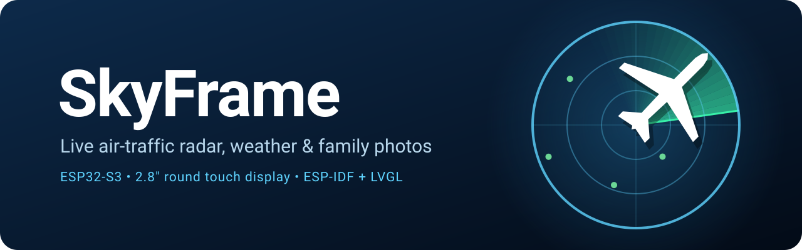

<p align="center">
  
</p>

<p align="center">
  
  
  
  
  
</p>

<p align="center">
  A round touch-screen display for the home that shows the planes flying overhead on a classic radar,<br>
  the weather and severe-weather alerts, a daily summary of the sky, a family photo slideshow,<br>
  the verse of the day, and birthdays.<br>
  It runs unattended and recovers from power cuts, Wi-Fi drops and missing data on its own.
</p>

---

## Highlights

<table>
<tr>
<td width="50%" valign="top">

### 🛩️ Live radar
Planes within your chosen radius (10 miles by default) at their true bearing and distance, gliding between updates under an animated sweep with an afterglow, drawn at about 30 frames a second. Flip on **satellite radar** in the pull-down panel and the scope sits over an aerial photo of the area, scaled to the radar (US only). Each icon shows **what the aircraft is** (13 shapes, from Cessnas and helicopters to business jets, fighters and four-engine jumbos), **sized by the aircraft** in 10% steps from light planes to the 747 and A380. Emergencies, VIP flights, military and notable airframes are color-coded. Airborne planes always come first; parked and taxiing ones are small dim dots, with a count next to the BWI marker.

</td>
<td width="50%" valign="top">

### 🔎 Tap a plane
A details page with a **photo of that exact airplane** (it fades in over a typical photo of its type), the airline and route (`IAD › LHR`), live altitude, speed, climb rate, heading, distance and squawk, and the full registry record. Special traffic explains *why it's highlighted*, such as what a 7600 squawk means.

</td>
</tr>
<tr>
<td valign="top">

### ⛅ Weather
Temperature and conditions with drawn icons, feels-like, today's low/high bar, humidity, wind, chance of rain, the next sunrise or sunset, a four-hour forecast and a large clock. **Severe-weather alerts** from the National Weather Service appear as a colored card (warning, watch, advisory); tap it for the full text, or swipe it aside to hide it for 5 minutes (a new or more severe alert shows at once).

</td>
<td valign="top">

### 🖼️ Family photos
A shuffled slideshow from the microSD card with nine transitions (fade, slides, iris, wipe, doors, blinds…). **Swipe** for the next photo with a page-turn effect. Add or remove photos from a phone.

</td>
</tr>
<tr>
<td valign="top">

### 📖 Verse of the day
BibleGateway's verse of the day in the NKJV (ESV as a fallback), refreshed every few hours.

</td>
<td valign="top">

### 🎂 Birthdays
On a family member's birthday their photo and age join the rotation all day. The device's owner gets a special page with a personal message. Managed from a phone or a text file.

</td>
</tr>
<tr>
<td valign="top">

### 📊 Today's sky
A daily summary in the rotation: how many planes passed, a photo of the **rarest aircraft** seen today, the highest, closest and fastest, planes per hour, and any VIP or military flights. Starts over at midnight.

</td>
<td valign="top">

### 🔔 Sighting alerts
A banner with a pulse around the rim pops up over any screen for **emergencies, Air Force One and VIP flights, military aircraft** and the types you pick (any 747 by default). A shorter **"Overhead now"** card appears when a plane passes within about a mile. Tap either to see it on the radar.

</td>
</tr>
</table>

**Polish:** every screen change has its own animation (the radar's last sweep wipes it away, a jet flies across into Today's sky, the verse opens like a book, photos turn in like a page, birthdays open with confetti), and a startup screen shows the radar logo and version while it joins Wi-Fi. Animations can be turned off.

**Around the clock:** dims from sunset and drops to a soft glow overnight (a touch brightens it). Joins the strongest of up to five saved Wi-Fi networks, reconnects on its own, and a watchdog restarts it if it ever freezes. It **updates itself overnight** from signed releases, and goes back to the previous version on its own if a new one doesn't start properly.

## Hardware

| Part | Details |
|---|---|
| Board | [Waveshare ESP32-S3-Touch-LCD-2.8C](https://www.waveshare.com/wiki/ESP32-S3-Touch-LCD-2.8C): ESP32-S3, 8 MB PSRAM, 16 MB flash |
| Display | 2.8" round 480×480 IPS (ST7701S), GT911 capacitive touch |
| Storage | microSD card, FAT32 (photos, plane photos, birthdays) |
| Enclosure | 3D-printable orb and back plate in [`hardware/`](hardware) (see [Enclosure](#enclosure)) |

## Getting started

**1. Build and flash** from the ESP-IDF 6.1.1 terminal, in the project folder:

```powershell
idf.py set-target esp32s3      # first time only
idf.py -p COM4 flash monitor   # the COM port of the board's "UART" USB-C port
```

Builds are signed, so updates can be checked: create a signing key once, **next to** the project
folder (never inside it), and keep a backup. Updates can only be signed with this key.

```powershell
espsecure generate-signing-key --version 2 --scheme rsa3072 ..\SkyFrame-signing-key.pem
```

The first build downloads LVGL, esp_jpeg, cJSON, mDNS and TinyUSB through the component manager. Quit the monitor with `Ctrl+]` before flashing again.

**2. Connect it to Wi-Fi.** On first start the screen shows a QR code. Scan it to join the `SkyFrame-XXXX` setup network, then scan the second code (or open **http://192.168.4.1**). Enter your 2.4 GHz Wi-Fi and the radar's center coordinates. SkyFrame restarts and joins your network.

**3. Prepare the microSD card** (optional, see [microSD card](#microsd-card)) for photos, plane pictures and birthdays.

## Using SkyFrame

| Gesture | Where | What happens |
|---|---|---|
| Swipe down from the top | Any screen | The [pull-down panel](#pull-down-panel) |
| Tap a plane | Radar | Opens its details page; tap again to close, scroll for the record |
| Tap an alert | Weather | The full National Weather Service text |
| Swipe an alert sideways | Weather | Hides it for 5 minutes |
| Swipe left or right | Photos | Next photo, with a page turn |
| Long press | Any screen | Skips to the next screen, which then runs its usual time |
| Hold **5 s** | Any screen | Settings screen with QR codes for the web pages |
| Hold **5 s** | Settings screen | [Test mode](#test-mode) |

The screens rotate: radar (up to 2 minutes, or less once the sky nearby is quiet), weather, Today's sky, the verse, photos, and on a birthday the birthday page.

### Pull-down panel

Swipe down from the top third of any screen:

| Control | What it does |
|---|---|
| Status line | The time and Wi-Fi |
| Brightness | Brighter or dimmer than the automatic level (evening and night dimming still apply); remembered |
| Radar · Weather · Today · Photos | Jump straight to that screen |
| Pause | Stay on the current screen (resumes by itself after an hour) |
| USB | Hand the microSD card to a connected computer |
| Settings | The settings screen with its QR codes |
| Page animations | Turn the screen-change animations on or off |
| Satellite radar | Show the radar over a satellite picture of the area; remembered |
| Radar range | Shows the radar radius; each tap steps 1 → 5 → 10 → 1 mi, saved and applied at once (the radar shows up for planes within 1, 3 and 5 miles). The settings page can still set any radius |

It closes with a swipe up, a tap below it, or after 20 s untouched.

<details>
<summary><b>Radar icons</b></summary>

The icon comes from the aircraft's broadcast category and its ICAO type code, and turns with its track (balloons, drones and ground vehicles stay upright).

| Icon | For | Size |
|---|---|---|
| Light plane | Cessna, Piper, Cirrus, ultralights | 60% |
| Business jet | Gulfstream, Challenger, Citation, Learjet, Falcon, Phenom, HondaJet, PC-24 | 70% |
| Helicopter | Category A7 or a known helicopter type | 70% |
| Turboprop | King Air (70%), ATR, Dash 8, Beech 1900, Saab 340 (80%), C-130 (90%) | 70-90% |
| Jet | Regional jets (80%), 737 and A320 family (90%), 757 (100%) | 80-100% |
| Wide-body | 767, 787, A330, A350, MD-11, KC-46 (777: 120%) | 110% |
| Four-engine jumbo | 747 and Air Force One, A380, A340, C-17, C-5, KC-135, B-52 | 110-120% |
| Fighter | F-16, F-15, F/A-18, F-35, F-22, A-10, T-38, Typhoon, Rafale | 100% |
| Tiltrotor | V-22 Osprey | 100% |
| Glider, balloon, drone | Their broadcast categories | 100% |
| Ground | Airport vehicles, and aircraft reported on the ground | 100% |

</details>

## Web pages

On the home Wi-Fi, open **http://skyframe.local** (or the IP address shown on the settings screen). On an iPhone, *Add to Home Screen* gives it a SkyFrame app icon.

| Page | What you can do |
|---|---|
| **Settings** `/` | Wi-Fi networks (up to five; the strongest one in range is used), radar center and radius, how long each screen stays up (verse and Today's sky can be turned off), page animations, night hours, and sighting alerts (emergencies, VIP, military, planes overhead, and a list of aircraft types such as `B74*, A388`) |
| **Photos** `/photos` | Add photos from a phone or computer (rotated and cropped in the browser), remove photos |
| **Birthdays** `/birthdays` | Add or remove people, set photos, mark the owner and write their birthday message |
| **Firmware update** `/update` | Install a signed `SkyFrame.bin` from a computer on the same Wi-Fi |

The settings screen on the device shows a QR code that opens these pages. If your phone isn't on the same Wi-Fi, *Other Wi-Fi* shows a code that joins SkyFrame's own network instead.

## microSD card

Format the card **FAT32**. SkyFrame never formats a card itself.

```
/photos/            slideshow photos (.jpg)
/planes/types/      one typical photo per aircraft type, e.g. B738.jpg
/planes/saved/      photos of individual planes, saved automatically after their first download
/planes/missing.txt types SkyFrame saw without a photo (written by SkyFrame)
/birthdays.txt      family birthdays (see tools/birthdays.example.txt)
/birthdays/         their photos, e.g. alex.jpg
```

| Content | How |
|---|---|
| **Slideshow photos** | Any JPEG up to 4 MB works, but prepared 480×480 photos load instantly: `python tools/prepare_photos.py C:\path\to\photos F:\photos` (needs `pip install pillow`) |
| **Plane type photos** | About 190 types from Wikipedia: `python tools/prepare_plane_photos.py F:\planes`. SkyFrame lists every type it sees without a photo in `planes/missing.txt`; now and then run `python tools/prepare_plane_photos.py F:\planes --missing` to fetch those too (it searches Wikipedia by the aircraft's description and takes found types off the list) |
| **Birthdays** | Copy `tools/birthdays.example.txt` to `/birthdays.txt`, one line per person: `Name, YYYY-MM-DD, photo.jpg`, and `owner` on the device owner's line. Square photos in `/birthdays/` look best |

**USB file transfer:** plug the board's native **USB** port (not "UART") into a computer and the card appears as a drive (or tap **USB** in the pull-down panel). SkyFrame shows "USB file transfer" and stays off the card. Eject the drive on the computer, then tap **Done**: SkyFrame takes the card back and picks up the changes.

## Test mode

Hold any screen for 5 s to open settings, then hold the settings screen's background for another 5 s. Test mode shows the SkyFrame version and build, and lets you preview features without waiting for the real event:

<details>
<summary><b>Tests and system information</b></summary>

| Test | What it does | Length |
|---|---|---|
| Owner's birthday | The owner's special birthday screen | 30 s |
| Family birthday | The upcoming birthdays from `birthdays.txt`, in date order (**Next birthday** steps through them) | 30 s |
| Sample traffic | A 737 squawking 7700, Air Force One, a C-17 and a medevac helicopter; tap them | 60 s |
| Night mode | The overnight glow; tap to brighten | 90 s |
| Screen tour | Every screen for 8 s each | about 50 s |
| USB transfer / Wi-Fi problem | Those screens | 10–15 s |
| Today's sky | A sample day, with a 747-8F as the rarest aircraft | 20 s |
| Startup | The startup screen, as at power-on | 7 s |
| Satellite radar | The radar over the satellite picture, without changing the setting | 30 s |
| Radar ranges | The 1, 5 and 10 mile presets, 10 s each, without changing the setting | 30 s |
| Weather alert | A sample Severe Thunderstorm Warning and Flood Watch; tap or swipe the card | 45 s |
| Sighting alert | An Air Force One banner over the weather; tap it for the radar | 25 s |
| Overhead now | A sample "Overhead now" card | 12 s |
| Check for updates | Checks for a newer version now and installs it; the button shows the result or the progress | |
| Restart | Restarts SkyFrame | |

The **System** panel shows CPU load per core, free memory, chip temperature, battery voltage, microSD space, Wi-Fi signal and channel, IP address, uptime, start count, the reason for the last restart, the last saved crash, and the update status. Tap the yellow **TEST** banner to stop a test early. Nothing in test mode is saved.

The serial log adds a line every 30 s with CPU load, free memory and frame timing (frames per second, drawing time per frame), and every 5 minutes the stack each task has left: useful for comparing builds on the device.

</details>

## Updates

SkyFrame updates itself from this repository's [GitHub releases](../../releases):

- Every night in the 3 AM hour it reads `latest.json` from the newest release. If it names a
  newer version, SkyFrame downloads `SkyFrame.bin` into its second firmware slot, checks the
  image and its **signature** (only firmware signed with SkyFrame's key is accepted), and
  restarts into it.
- The new version must **prove itself**: join Wi-Fi and run for a minute. If it crashes or
  freezes first, the bootloader starts the previous version again, and the failed version is
  never offered again. Settings and the microSD card are untouched.
- The next time the screen is free it shows **"Updated to v…"** with the release notes.
- Test mode's **Check for updates** does the same on demand; **http://skyframe.local/update**
  installs a build from a computer; USB flashing always works.

Publishing a release (tests, simulator, signed build, tag and GitHub release in one go):

```powershell
.\tools\release.ps1 0.5.1 "Smoother radar and a new Today's sky"
```

The flash is split into two 6 MB firmware slots plus a crash-report area (`partitions.csv`).
Changing that layout can only be installed over USB; the settings area never moves.

## PC simulator

See changes without the device: [`sim/`](sim) builds the same firmware for Windows and runs it in a round window, with **live data** from the same services (real planes overhead, real weather and alerts). The mouse is your finger.

```powershell
.\sim\run.ps1                    # build what changed, then start
.\sim\run.ps1 39.18 -76.67       # center the radar somewhere else
```

`main/main.c` and the components compile unchanged; only the hardware is stood in for (display, touch, Wi-Fi, microSD, USB). It needs [MSYS2](https://www.msys2.org) with the UCRT64 `gcc`, `SDL2`, `curl`, `cmake` and `ninja` packages, and one `idf.py build` first (it reads the firmware's display settings). Copy the card's folders into `sim\sdcard\` for photos; `python tools/prepare_plane_photos.py sim\sdcard\planes` fetches the plane pictures. See [`sim/README.md`](sim/README.md), including scripted input and screenshots.

## Enclosure

A round orb housing and a back plate, ready to print:

| File | Part |
|---|---|
| [`hardware/SkyFrame_orb_v2.stl`](hardware/SkyFrame_orb_v2.stl) | Orb housing |
| [`hardware/SkyFrame_plate_v2_no_notch.stl`](hardware/SkyFrame_plate_v2_no_notch.stl) | Back plate |

GitHub shows both as interactive 3D models: open a file to rotate it.

## Under the hood

<details>
<summary><b>Project layout</b></summary>

| Path | Contents |
|---|---|
| `main/main.c` | Startup, display loop, traffic/weather/info workers, screen scheduling, test mode |
| `main/birthdays.c`, `plane_library.c` | Birthdays and offline plane photos on the microSD card |
| `main/{LCD,Touch,I2C,LVGL}_Driver`, `EXIO`, `SD_Card` | Board drivers (from Waveshare's demo, updated for ESP-IDF 6) |
| `components/skyframe_engine` | ADS-B parser, geo math, screen scheduler, Today's sky tally and special-traffic rules |
| `components/skyframe_ui` | Radar, aircraft icons and the details page |
| `components/skyframe_screens` | Weather and alerts, slideshow, verse, birthdays, Today's sky, settings and test screens, pull-down panel, banners, screen transitions, startup screen |
| `components/skyframe_net` | HTTPS: adsb.fi, Open-Meteo, National Weather Service, adsbdb, BibleGateway, photo downloads |
| `components/skyframe_portal`, `skyframe_config` | Wi-Fi, web pages, settings in NVS |
| `components/skyframe_storage` | microSD ownership and USB mass storage |
| `components/skyframe_update` | Over-the-air updates, rollback, crash reports |
| `components/skyframe_photoplayer`, `skyframe_jpeg` | Background photo decoding and scaling |
| `tools/` | Photo preparation scripts, icon and banner generators, `release.ps1` |
| `hardware/` | 3D-printable enclosure (orb and back plate) |
| `sim/` | PC simulator: the firmware in a window, with live data (`sim\run.ps1`) |
| `tests/` | Host unit tests for the portable code (`sh tests/run_tests.sh`, needs a C compiler) |
| `CLAUDE.md` | How the project is built, tested and released (read by Claude Code) |

</details>

<details>
<summary><b>Performance notes</b></summary>

- The radar sweep is paced to the panel's refresh and redraws only thin strips along the beam; the rings are pre-drawn once into an image.
- Each plane is a single drawn object, so a moving plane touches about two screen areas per update.
- Screens hidden behind an overlay (settings, test mode, USB) are paused.
- Photos decode one or two ahead on the second core; large buffers live in PSRAM to keep internal RAM free for Wi-Fi.
- Screen transitions start from a copy of the panel's frame buffer (one memory copy) and redraw only what changes where they can, such as the slice the sweep passes over.

</details>

## Data sources

| Data | Source |
|---|---|
| Live traffic | [adsb.fi](https://adsb.fi) open data |
| Aircraft records and routes | [adsbdb.com](https://www.adsbdb.com) |
| Airframe photos | [airport-data.com](https://www.airport-data.com) |
| Weather | [Open-Meteo](https://open-meteo.com) |
| Severe-weather alerts | [National Weather Service](https://www.weather.gov/documentation/services-web-api) (US only) |
| Satellite radar picture | [USGS The National Map](https://www.usgs.gov/programs/national-geospatial-program/national-map) imagery, public domain (US only) |
| Type photos | Wikipedia lead images, hosted on Wikimedia Commons |
| Verse of the day | [BibleGateway](https://www.biblegateway.com) |

All of these are free, best-effort services. Flight data here is for interest only, never for navigation or safety.

## Known limitations

- Insert the microSD card before power-on; hot-swapping isn't detected.
- The web pages use plain HTTP with no login: anyone on the home Wi-Fi (or the password-protected setup network) can use them.
- Unprepared phone photos decode slowly (a few seconds each); use `tools/prepare_photos.py`.
